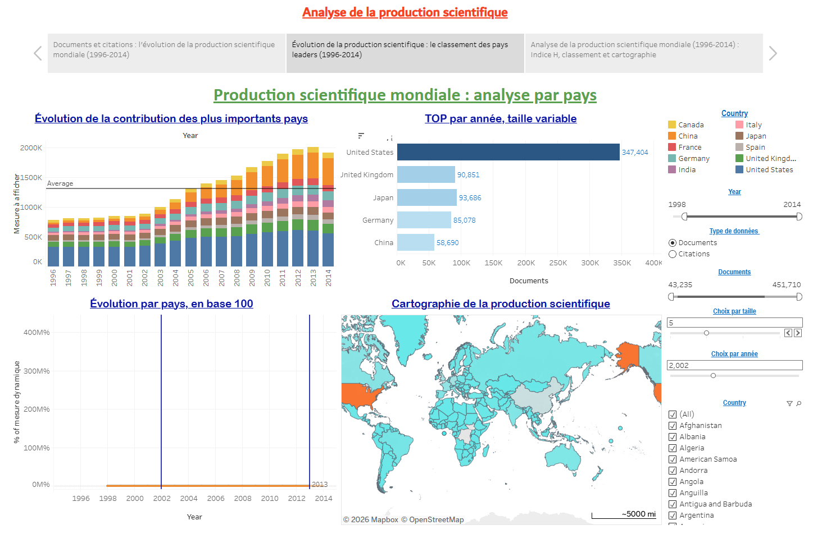
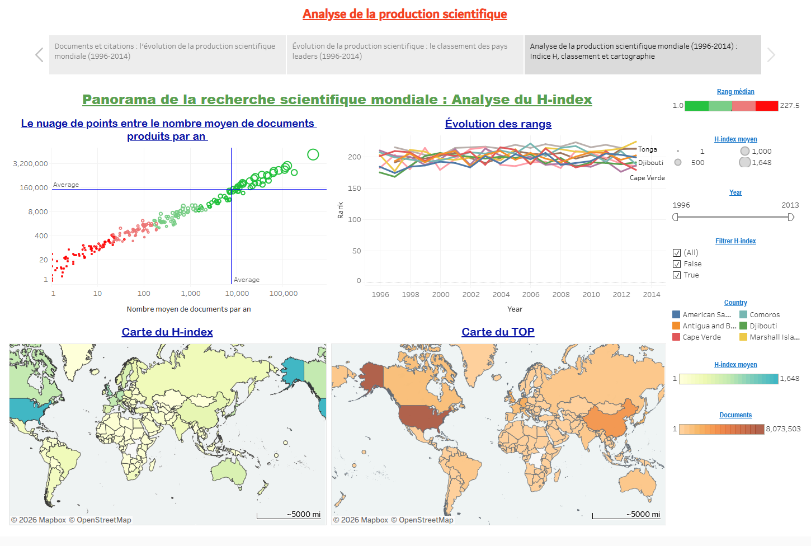

# Global Scientific Production (1996-2014) - Tableau

[](#overview)
[](#dataset)
[](#dashboards)
[](#preview)
[](#repository-structure)
[](#authors)

## Overview

An interactive **Tableau Story** analysing the world's scientific production between **1996 and 2014**: documents, citations, H-index and country rankings, with maps and time series.

- **Live version (Tableau Public):** [Analyse de la production scientifique](https://public.tableau.com/app/profile/abdessamad.ait.brahim/viz/Histoire1-Analysedelaproductionscientifique/Analysedelaproductionscientifique)
- **Project report:** [docs/project_report.pdf](docs/project_report.pdf)

## Dataset

Country-level indicators per year, from **1996 to 2014**: `Country`, `Year`, `Documents`, `Citations`, `H index`, `Rank`. File: [data/scimagojr_all.xlsx](data/scimagojr_all.xlsx).

Source: SCImago, (n.d.). SJR - SCImago Journal & Country Rank [Portal]. Retrieved from https://www.scimagojr.com (data used for non-commercial purposes, with citation).

## Dashboards

The story contains three dashboards:

| Dashboard | Content |
|---|---|
| **1. Contribution of the leading countries** | Top 10 countries by production, evolution of documents and citations, filters on documents and years |
| **2. Analysis by country** | Contribution of the main countries over time, TOP by year with variable size, evolution by country (base 100), world production map |
| **3. H-index overview** | Documents vs. citations scatter plot, rank evolution, H-index map and TOP map, filters on median rank, H-index and year |

Interactive controls: indicator selector (documents or citations), year and size parameters, country filters and highlight actions.

## Preview





## Repository structure

```
tableau-global-scientific-production/
├── tableau/
│   ├── scientific_production_dashboard.twb     # full workbook (10 worksheets, 3 dashboards)
│   └── individual_views/                       # earlier versions of single views
├── data/
│   └── scimagojr_all.xlsx
├── docs/
│   ├── project_report.pdf
│   └── images/
└── README.md
```

## How to use

1. Install Tableau Desktop or [Tableau Public](https://public.tableau.com/) (free), or simply open the live version above.
2. Open `tableau/scientific_production_dashboard.twb`.
3. If Tableau cannot find the data, click **Edit connection** on the data source and select `data/scimagojr_all.xlsx`.

## Authors

Abdessamad Ait Brahim ([@abdessamadaitbrahim](https://github.com/abdessamadaitbrahim)) and Ayyoub Amazal

Program: Big Data and AI. Module: Data Visualization.